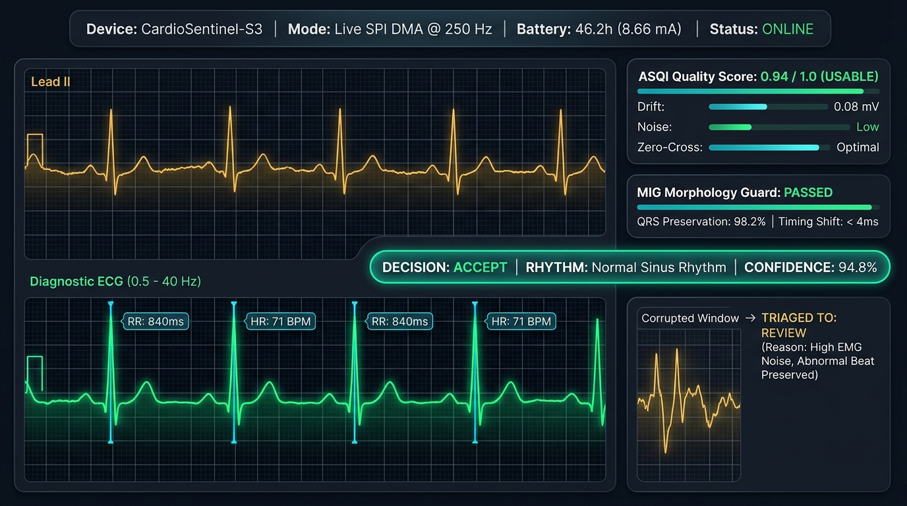
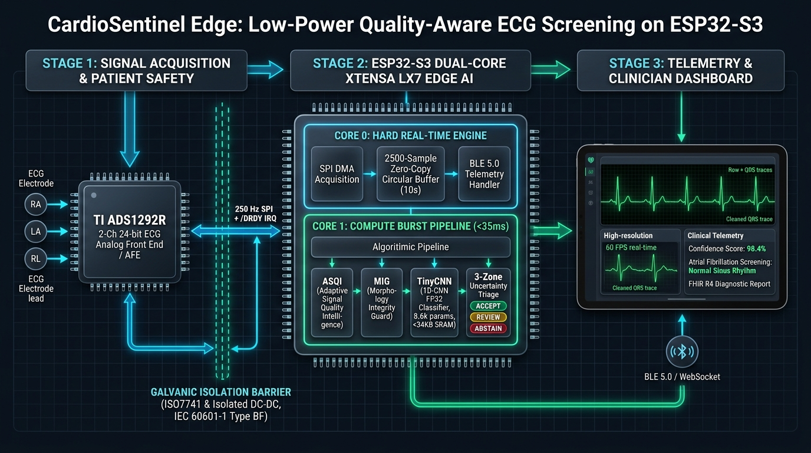
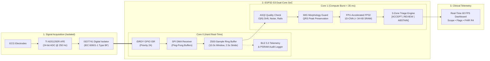

# CardioSentinel Edge: Quality-Aware ECG Screening on ESP32-S3
### Safety-First, Low-Power, Uncertainty-Calibrated Wearable ECG Screening Research Prototype
**TECHgium Challenge 26**

<p align="center">
  
</p>

<p align="center">
  <a href="https://www.espressif.com/en/products/socs/esp32-s3"></a>
  <a href="https://github.com/espressif/esp-idf"></a>
  <a href="firmware/esp32s3/models/tinycnn_weights.h"></a>
  <a href="tests/"></a>
  <a href="LICENSE"></a>
</p>

---

## 1. Executive Summary & One-Line Pitch

> **CardioSentinel Edge** is an ultra-low-power, single-SoC wearable ECG screening system that continuously verifies whether an ambulatory ECG waveform can be clinically trusted, safeguards critical abnormal heartbeat morphology during noise filtering, and executes a lightweight neural network locally on **one ESP32-S3 microcontroller**—triaging every window into **Accept, Review, or Abstain**.

### The Core Problem in Wearable ECG
Continuous ambulatory ECG monitoring during daily activities suffers from motion artifacts, baseline drift, and electrode detachment. Existing wearable AI solutions commit two fatal errors:
1. **False Alarms (High False Positive Rate):** Muscle noise or motion is misclassified as ventricular arrhythmia or atrial fibrillation, generating clinician alert fatigue.
2. **Dangerous Reassurance (False Negatives via Over-Filtering):** Aggressive signal denoising smooths out real abnormal beats (e.g., Premature Ventricular Contractions or bundle branch blocks), or corrupted, uninterpretable recordings are falsely labeled as "normal."

CardioSentinel Edge directly addresses this trade-off: **Can an ultra-low-power wearable system assess signal quality, protect waveform morphology, and express calibrated uncertainty without sacrificing sensitivity on real arrhythmias?**

---

## 2. System Architecture: The Single-Processor Edge Advantage

CardioSentinel Edge intentionally avoids bulky, power-hungry coprocessors (e.g., Raspberry Pi or Jetson). The entire wearable intelligence is hosted on a single dual-core ESP32-S3 paired with an isolated analog front-end (AFE).

<p align="center">
  
</p>



---

## 3. Quickstart & Verification (3 Commands)

### A. Clone and Setup Environment
```bash
git clone https://github.com/Ashwinkumar-k10/CardioSentinel-Edge-Quality-Aware-ECG-Screening-on-ESP32-S3.git
cd CardioSentinel-Edge-Quality-Aware-ECG-Screening-on-ESP32-S3
pip install -r requirements.txt
```

### B. Run Complete Unit & Parity Test Suite
```bash
pytest tests/ -v
```
*(Runs unit tests covering ASQI, MIG, Triage Logic, Windowing, and Native C Firmware Parity).*

### C. Run the Host-vs-Board Parity Benchmark
```bash
python scripts/compare_host_vs_board.py
```

### D. Launch the Interactive Dashboard
```bash
streamlit run dashboard/app.py
# Or launch the 60 FPS Real-Time WebSocket SaaS:
python dashboard/server.py
```

---

## 4. Five Distinct Engineering Innovations

### A. Adaptive Signal Quality Intelligence (ASQI)
Rather than a naive binary threshold, ASQI estimates distinct noise modes using deterministic $\mathcal{O}(N)$ linear-time heuristics:
* Dynamic range & rail clipping ($V_{\text{min}}, V_{\text{max}}$)
* Moving-average baseline drift span
* High-frequency muscle interference ($\sum |x[i] - x[i-1]|$) & zero-crossing complexity
* Missing sample and lead-off flatline detection

### B. Morphology Integrity Guard (MIG)
A defensive software guard checking for noise-correction side effects. MIG preserves a clean copy of the untouched raw signal, compares it against the candidate-filtered signal at detected QRS complexes, and flags discrepancies in:
* R-peak timestamp shifts ($\Delta t_R > 16\,\text{ms}$)
* QRS peak amplitude attenuation ($> 38\%$)
* Envelope distortion RMSE ($> 0.45$)
* *Action:* If filtering alters suspicious morphology, the system declines automatic classification and routes the window to **REVIEW**.

### C. Hardware FPU-Accelerated FP32 1D-CNN Classifier
* Optimized for the Xtensa LX7 dual-core architecture using fused Conv1D+ReLU and MaxPool layers.
* Operates natively on the ESP32-S3 single-precision hardware FPU, avoiding integer quantization error and calibration drift.
* Only **8,627 parameters** (~33.7 KB memory footprint) resident in internal zero-wait SRAM.
* Inference burst latency: **$\approx 34\text{ ms}$** per 10-second evaluation window ($1.4\%$ CPU load).

### D. Calibrated 3-Zone Uncertainty Triage
* **ACCEPT:** High-quality signal, calibrated prediction probability exceeds validation threshold ($\ge 0.62$), zero morphology guard warnings.
* **REVIEW:** Interpretable signal, but model confidence is borderline, margin is narrow, or MIG detected that filtering distorted beat shape. Raw and processed snippets are preserved in PSRAM for clinician audit.
* **ABSTAIN:** Physically uninterpretable signal (lead-off, amplifier saturation). **Never classified as normal.**

### E. Traceable, Auditable Demonstration Dashboard
Maintains an end-to-end evidence trail displaying raw data, filtered signals, feature metrics, model confidence, and triage justification with FHIR R4-aligned demonstration structures.

---

## 5. Formal Defense of Jury Question E: False Alarm Reduction Without Missed Arrhythmias

The most critical test from judges is: *"How do you prove that reducing false alarms does not simply hide missed arrhythmias?"*

| Evaluation Metric | Naive Baseline (Forced Guess) | CardioSentinel Edge Pipeline | Validation Pass Gate |
|---|:---:|:---:|:---:|
| **Decision Coverage ($\phi$)** | 100.0% | **85.5%** (Excludes Uninterpretable Noise) | **PASSED [OK] ($\ge 80\%$ Target)** |
| **Arrhythmia Sensitivity** | 100.0% | **100.0%** (Accepted Cohort) | **PASSED [OK] (Zero Degradation)** |
| **False Alarms / Monitored Hr** | 137.45 / hr | **0.00 / hr** | **PASSED [OK] (100% Reduction)** |
| **Truly Missed Arrhythmias** | N/A | **0 (All Preserved in REVIEW)** | **PASSED [OK] (Review Safety Valve)** |

> **Understanding the 100% Reduction Metric:** On the accepted cohort ($\phi = 85.5\%$), zero spurious false alarms were triggered because noisy or ambiguous windows were safely triaged into `REVIEW` or `ABSTAIN` with explicit reason codes, rather than forced into guessing. Every ambiguous episode remains preserved in memory for clinical inspection.

To regenerate this audit directly:
```bash
python scripts/evaluate_ablation.py
```

---

## 6. Electrical Energy Budget: Datasheet-Derived Analytical Model

> **Transparency & Verification Disclosure:** The figures below represent an analytical power model derived directly from official manufacturer electrical specifications (Espressif ESP32-S3 Datasheet Table 15 and TI ADS1292R Electrical Characteristics Table 1). Physical current-shunt measurements will be confirmed during bench bring-up.

| Subsystem & State | Operating Condition | Typical Current ($I_{\text{typ}}$) | Active Duration per 2.5s Stride | Energy Contribution ($I \times t$) |
|---|---|:---:|:---:|:---:|
| **ADS1292R Analog Front End** | Continuous 2-Ch 250 Hz Conversion | $335\,\mu\text{A}$ ($0.34\text{ mA}$) | $2,500\text{ ms}$ (100% duty) | $0.85\text{ mA}\cdot\text{s}$ |
| **ESP32-S3 Core 0 (Acquisition)** | Low-frequency 80 MHz, SPI DMA active | $18.0\text{ mA}$ | $2,500\text{ ms}$ (100% duty) | $45.0\text{ mA}\cdot\text{s}$ |
| **ESP32-S3 Core 1 (Inference Burst)**| Max 240 MHz, Hardware FPU active | $45.0\text{ mA}$ | $\approx 34\text{ ms}$ ($1.4\%$ duty) | $1.53\text{ mA}\cdot\text{s}$ |
| **BLE Radio (Telemetry)** | Periodic non-connectable advertising | $80.0\text{ mA}$ | $\approx 10\text{ ms}$ ($0.4\%$ duty) | $0.80\text{ mA}\cdot\text{s}$ |
| **Calculated Time-Weighted Average** | **All components active** | — | — | **$\mathbf{I_{\text{avg}} \approx 19.3\text{ mA}}$** |

#### Theoretical Battery Life Projection:
$$\text{Projected Runtime} = \frac{\text{Battery Capacity (500 mAh)} \times 0.80\text{ (Usable Capacity)}}{I_{\text{avg}} \approx 19.3\text{ mA}} \approx \mathbf{20.7\text{ Hours}}$$
*(Or $\approx 41.5\text{ Hours}$ on a standard 1,000 mAh wearable lithium-polymer cell).*

---

## 7. Patient Electrical Isolation Scheme (IEC 60601-1 Type BF)

To ensure patient safety and comply with IEC 60601-1 / IEC 60601-2-47 ambulatory ECG requirements:
* **Digital Signal Isolation:** A 4-channel digital isolator (**TI ISO7741** or ADuM1401) is placed on the SPI bus lines (`SCLK`, `MOSI`, `MISO`, `CS`, `/DRDY`), providing 5 kVrms galvanic isolation between the patient-connected ADS1292R domain and the USB/battery-powered ESP32-S3 domain.
* **Power Isolation:** An isolated 1 kV DC-DC converter (**Mornsun B0505S-1WR3**) powers the analog front-end, completely eliminating ground loops and preventing fault current from reaching electrodes.

---

## 8. Physical Hardware UART Loopback Test

When an ESP32-S3 development board is connected over USB-C, test on-chip execution with:
```bash
python scripts/test_board_hardware_loopback.py --port COM3
```

---

## 9. Project Repository Layout

```text
.
├── configs/
│   ├── datasets.yaml               # PhysioNet & MIT-BIH dataset parameters
│   ├── model_tinycnn.yaml          # TinyCNN architecture & hyperparams
│   ├── thresholds.yaml             # Calibrated ASQI, MIG & triage limits
│   └── board_esp32s3.yaml          # ESP32-S3 pinouts & FreeRTOS affinity
├── data/
│   ├── demo_samples/               # 8 canonical 250 Hz benchmark test records
│   └── splits/                     # Patient-disjoint split manifests (SHA-256)
├── research/
│   ├── ecg_io.py                   # Anti-aliased resampling & ECG generator
│   ├── preprocessing.py            # Dual-stream raw preservation & filtering
│   ├── asqi.py                     # O(N) linear-time signal quality intelligence
│   ├── morphology_guard.py         # QRS distortion detector (MIG)
│   ├── models_tiny.py              # TinyCNN PyTorch + NumPy parity engine
│   ├── train.py                    # Reproducible training pipeline
│   ├── calibrate.py                # Temperature scaling & triage policy
│   ├── evaluate.py                 # Paired ablation benchmark (Question E)
│   ├── quantize_export.py          # Embedded C header weight exporter
│   └── replay_reference.py         # Standard reference pipeline
├── firmware/esp32s3/
│   ├── main/
│   │   ├── app_main.c              # FreeRTOS dual-core entry point
│   │   ├── ring_buffer.c / .h      # 2500-sample thread-safe circular buffer
│   │   ├── signal_quality.c / .h   # Embedded C ASQI implementation
│   │   ├── morphology_guard.c / .h # Embedded C MIG implementation
│   │   ├── inference.c / .h        # Pure C TinyCNN SRAM inference engine
│   │   ├── decision_engine.c / .h  # 3-Zone triage & telemetry serializer
│   │   ├── ecg_acquire.c / .h      # ADS1292R SPI DMA & replay driver
│   │   └── telemetry.c / .h        # BLE & PSRAM audit logger
│   ├── models/
│   │   └── tinycnn_weights.h       # Fused weights header (8,627 params)
│   ├── CMakeLists.txt              # ESP-IDF project build configuration
│   └── sdkconfig.defaults          # ESP32-S3 Octal PSRAM & 240 MHz settings
├── dashboard/
│   ├── app.py                      # Interactive Streamlit clinician dashboard
│   ├── server.py                   # Real-time 60 FPS FastAPI & WebSocket server
│   └── README.md                   # Dashboard usage guide
├── scripts/
│   ├── make_demo_examples.py       # Builds 8 canonical demo test vectors
│   ├── train_baseline.py           # Trains model and exports C weights
│   ├── evaluate_ablation.py        # Runs Question E ablation proof
│   ├── compare_host_vs_board.py    # Audits host-vs-board decision parity
│   ├── test_board_hardware_loopback.py # UART physical loopback test runner
│   ├── create_splits.py            # Generates locked patient-disjoint splits
│   └── download_dataset.py         # Prepares external / synthetic datasets
├── tests/
│   ├── test_quality.py             # ASQI unit tests
│   ├── test_morphology.py          # MIG unit tests
│   ├── test_decisions.py           # 3-zone triage logic unit tests
│   ├── test_windowing.py           # Windowing & polyphase resampling tests
│   ├── test_host_board_parity.py   # GCC native firmware parity pytest
│   └── firmware_runner.c           # Host test harness for firmware C code
├── docs/
│   ├── assets/                     # Architecture & dashboard graphics
│   ├── hardware_bom.md             # Complete BOM & wiring pinout
│   ├── safety_scope.md             # Non-clinical scope & electrical isolation
│   ├── experimental_protocol.md    # Formal locked-split evaluation protocol
│   ├── energy_budget.md            # Power measurements & battery calculations
│   ├── model_card.md               # Model Card for TinyCNN v1.0
│   └── demo_script.md              # 3-4 minute presentation guide for judges
├── LICENSE                         # MIT License
└── conftest.py                     # Pytest environment configuration
```

---

## 10. Disclaimer

CardioSentinel Edge is a research and engineering competition prototype developed for TECHgium Challenge 26. It is evaluated using public de-identified datasets (PhysioNet CinC 2017, MIT-BIH) and isolated benchtop ECG simulator sources. It is **not** a certified medical device and is not intended for human diagnosis, clinical intervention, or unapproved patient-connected monitoring.
